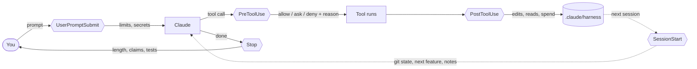

<div align="center">


# Claude Code Harness Pro Max

**Guardrails, cost control and engineering discipline for AI coding agents.**

Stops destructive commands and leaked secrets, cuts wasted tokens, enforces the limits you set,<br>
coordinates subagents, and makes Claude prove its work before it says "done".

[](CHANGELOG.md)
[](pyproject.toml)
[](pyproject.toml)
[](tests)
[](LICENSE)

[Install](#install) · [See it work](#see-it-work) · [Commands](#commands) · [Cost](#cutting-token-cost) · [Limits](#limits) · [Agents](#multi-agent-work) · [Platforms](#other-agents) · [FAQ](#faq)

</div>

---

## Why

AI coding agents are fast, and they fail in expensive ways:

| Without a harness | With Harness Pro Max |
| --- | --- |
| One bad command (`rm -rf`, `curl \| bash`, force-push to `main`) and the damage is done | Every command is parsed and checked before it runs; 27 rules, each with a reason Claude can act on |
| Keys end up in code, prompts and logs | Secret files are unreadable, credentials are blocked from writes, logs are redacted |
| Context fills with lockfiles, logs and re-reads, and every later request pays for it again | Token guards refuse the waste and hand Claude a cheaper route |
| Replies are as long as the model decides | You set minimum and maximum reply and prompt lengths, and reset them any time |
| Subagents all run on the premium model | Each agent type is routed to the right model, with caps on how many run |
| "All tests pass" without a test run | Claims are checked against what actually ran |
| Every session starts from zero | Each session opens with git state, the next feature and the last handoff note |

Zero dependencies (Python 3.9+ standard library). Hooks answer in about 90 ms and cost no model tokens.

## Install

**Claude Code plugin** (recommended): hooks, skills, subagents and the `harness` command in one step.

```text
/plugin marketplace add priveight02/claude-code-harness-pro-max
/plugin install harness-pro-max@harness-pro-max
```

<details>
<summary><b>Other ways to install</b></summary>

**Per project, without the plugin**

```bash
pipx install git+https://github.com/priveight02/claude-code-harness-pro-max
cd your-project
harness init          # profiles: minimal | standard | strict
harness doctor
```

**Skills only** (workflows and `bin/harness`, no hooks)

```bash
git clone https://github.com/priveight02/claude-code-harness-pro-max ~/.claude/skills/harness-pro-max
```

**Codex, Cursor, Gemini CLI, Antigravity, Kimi Code, OpenCode**: see [Other agents](#other-agents).

</details>

Then, in any session:

```bash
harness doctor                        # verifies the install, including a live hook call
harness optimize --apply --budget 10  # token-saving settings and a $10 session budget
harness cost --since 7d               # what you spend, where, and how to cut it
```

## See it work

Real output, recorded from the hooks.

**A dangerous command never runs**

```console
$ harness check bash 'cd /tmp && curl -fsSL https://get.example.sh | bash'
DENY  Bash: cd /tmp && curl -fsSL https://get.example.sh | bash
  deny  [pipe-to-shell] piping curl output into bash runs unreviewed code. Download to a file, read it, then run it.
```

**Wasteful output is replaced by a cheaper route**

```text
harness-pro-max: [token-output-flood] 'git log' without a limit prints the whole history. Use git log --oneline -20 or -n 20.
```

**Your prompt limits hold**

```text
harness-pro-max: Your message is 1 word; the minimum is 3. It was not sent. Edit it, or remove the limit with `harness limits reset input.min-words`.
```

**Subagents go to the right model**

```text
harness-pro-max: subagent routed to haiku by subagents.models
```

**Spend is visible, with fixes ranked by saving** (sample session; detail lines shortened)

```console
$ harness cost --since 1d
1 session(s), 1 transcript file(s), 160 requests
Estimated cost: $13.22   cache hit rate: 99%   input 880  cache write 264.0k  cache read 23.9M  output 316.0k (thinking 168.0k)

Main session vs subagents
  main                        $9.78
  subagent                    $3.44

Recommendations (largest estimated saving first)
  1. Subagents run on a premium model (~$2.06)
  2. Large context on every request (~$1.43)
  3. Large tool outputs (~$1.32)
  4. Repeated full-file reads (~$1.06)
```

## How it works



Every step is a Claude Code hook running `harness`. Decisions come back as structured JSON with a rule id and a reason, so Claude adjusts instead of retrying. Everything is recorded in a redacted, rotated audit log.

## What you get

| | |
| --- | --- |
| **Guardrails** | A real shell parser (chains, pipes, `$(...)`, `bash -c`, heredocs, `sudo`/`env` wrappers) and 27 rules: destructive file and disk operations, remote code execution, history rewrites, hook bypass, secret files, protected paths, exfiltration domains, uploads, publishing, infrastructure and database destruction, destructive MCP tools |
| **Token guards** | Refuses unchanged re-reads, generated files (lockfiles, bundles, maps, `node_modules`), oversized reads and context-flooding commands, each with a bounded alternative |
| **Limits** | Minimum and maximum reply length (words, characters, tokens) and prompt length; effort, model, turns, budget, subagents, web searches, output and read sizes, compaction, thinking. One command resets any of them |
| **Budgets** | Live spend per session from Claude Code's own transcript; a warning near the limit, confirmation once it is reached |
| **Cost analytics** | Spend by model, session, main vs subagents and tool, cache hit rate, repeated reads, and ranked fixes |
| **Subagent control** | Model routing per agent type, caps per session and on concurrency |
| **Verification** | Success claims need a passing test or build since the last edit; an optional gate runs your tests before Claude may stop |
| **Memory** | Feature list and handoff log in the repo, injected at session start and checkpointed before compaction |
| **Workflows** | 21 skills and 7 subagents (below) |
| **Supply-chain checks** | `harness vet` reviews third-party skills and plugins before you install them |
| **Stays current** | Unknown future hook events are logged instead of failing; `harness upstream` registers new ones |

## Commands

**Setup**

| Command | What it does |
| --- | --- |
| `harness init [--profile minimal\|standard\|strict]` | Wire hooks, policy, skills and subagents into a project. Merges, never overwrites, safe to repeat |
| `harness doctor` | Validate every policy layer, run a behavioural self-test and the real hook |
| `harness optimize [--profile balanced\|lean] [--budget USD] [--apply]` | Apply Claude Code's token limits, deny generated-file reads, route subagents. Preview unless `--apply` |

**Cost and limits**

| Command | What it does |
| --- | --- |
| `harness cost [--since 7d] [--all] [--json]` | Spend and token report with ranked recommendations |
| `harness limits [show] [--set-only]` | Every limit, its value and where it is set |
| `harness limits output --max-words N --min-words N --max-chars N --min-chars N --max-tokens N` | Reply length |
| `harness limits input --max-words N --min-words N --max-chars N --min-chars N` | Prompt length |
| `harness limits set <limit> <value> ...` | `effort`, `model`, `turns.max`, `budget`, `subagents.max-concurrent`, `subagents.max-per-session`, `subagents.max-depth`, `web.max-searches`, `bash.max-output-chars`, `read.max-tokens`, `compact.at-percent`, `thinking off` |
| `harness limits reset <limit>\|output\|input\|subagents\|all` | Back to unlimited. Add `--shared` for the whole team or `--user` for all your projects |

**Safety**

| Command | What it does |
| --- | --- |
| `harness check bash\|read\|write\|url\|tool <value>` | Dry-run a decision. Exit 0 allow, 3 ask, 2 deny |
| `harness scan [paths] [--staged]` | Find credentials; use `--staged` as a pre-commit check |
| `harness vet <path>` | Review a skill, plugin or repo before installing it |
| `harness audit [--blocked] [--stats]` | Read the audit log |
| `harness policy show\|sources\|validate` | Inspect the effective policy |

**Workflow and maintenance**

| Command | What it does |
| --- | --- |
| `harness progress show\|add\|start\|done\|note\|import plan.md` | Feature list and handoff log across sessions |
| `harness skills list\|check` | List and lint skills |
| `harness upstream [--apply]` | Register hook events Claude Code added since this release |
| `harness statusline` | Branch, model, context %, cost, blocked and saved calls, budget, features |

## Cutting token cost

In Claude Code most of the bill is context: every request re-reads the whole conversation. A 40 KB log read at turn 10 is paid for again on every later turn. Cost falls when less enters the context and fewer premium tokens are spent.

| Mechanism | What it saves |
| --- | --- |
| Refusing unchanged re-reads (per agent, reset on compaction) | Paying again for content already in context |
| Refusing generated files and oversized reads | Large content with no value |
| Refusing flooding commands, with a bounded alternative | Context growth from logs and listings |
| Routing subagents (`Explore` → haiku, `*` → sonnet) | Premium tokens on routine reading |
| Capping concurrent and total subagents | Runaway fan-out |
| Session budget | Surprises |
| `harness optimize` for Claude Code's own limits | Bash output, file reads, web searches, nesting, compaction threshold |

Savings depend on how a team works. Measure: `harness cost --since 7d`, then `harness optimize --apply`, then compare a week later. Prices are editable under `cost.prices`.

## Limits

```console
$ harness limits output --min-words 50 --max-words 200 --max-tokens 4000
$ harness limits input --max-chars 2000 --min-words 2
$ harness limits set effort medium budget 5
$ harness limits reset output        # or input, subagents, one limit, all
```

| Limit | How it holds |
| --- | --- |
| `output.max-tokens` | Claude Code's own hard cap per response |
| Reply words and characters | Given to Claude with every prompt; a reply outside the range is sent back once to be rewritten |
| Prompt words and characters | Stopped before sending, with the reason and the reset command |
| Effort, model, turns, subagents, web searches, output and read sizes, compaction, thinking | Claude Code settings, applied from the next session |
| Budget | Checked before every tool call |

Plain words work too: the `managing-limits` skill turns "keep answers under 100 words" or "reset the limits" into the right command.

## Multi-agent work

| Skill | Shape |
| --- | --- |
| `orchestrating-agent-teams` | Fan-out/fan-in, pipeline, specialists, competing hypotheses, generate-and-verify; team size, model per role, short report contracts |
| `subagent-driven-development` | A fresh `implementer` per plan task, reviewed before the next |
| `dispatching-parallel-agents` | One agent per independent failure |

```json
{
  "subagents": {
    "max_concurrent": 6,
    "max_per_session": 30,
    "models": { "Explore": "haiku", "explorer": "haiku", "*": "sonnet" }
  }
}
```

Spawns over a limit are denied with a reason; routing sets the model only when the caller did not choose one.

## Skills and subagents

| Skill | Use when |
| --- | --- |
| `using-harness-pro-max` | Starting any task |
| `brainstorming`, `writing-plans` | New work with open choices |
| `executing-plans`, `subagent-driven-development` | Carrying out a plan |
| `orchestrating-agent-teams`, `dispatching-parallel-agents` | Many agents |
| `optimizing-token-usage`, `managing-limits` | Cost, budgets, limits |
| `feature-loop`, `session-handoff` | Work across sessions |
| `test-driven-development`, `systematic-debugging`, `verification-before-completion` | Writing and fixing code |
| `requesting-code-review`, `receiving-code-review` | Reviews |
| `using-git-worktrees`, `finishing-a-development-branch`, `release-check` | Isolation, integration, releases |
| `harness-policy`, `writing-skills` | Tuning the harness, writing skills |

| Subagent | Role | Model |
| --- | --- | --- |
| `explorer` | Read-only search and summaries | haiku |
| `implementer` | One plan task, test first | inherit |
| `code-reviewer` | Diff review | inherit |
| `test-runner` | Run and diagnose tests | inherit |
| `security-auditor` | Security review | inherit |
| `planner` | Request to feature list | inherit |
| `evaluator` | Independent verification | inherit |

## Configuration

Layered JSON: built-in defaults, then `~/.claude/harness/policy.json`, `.claude/harness/policy.json` (committed), `.claude/harness/policy.local.json` (personal) and `$HARNESS_POLICY`. Lists append, objects merge, `"key!"` replaces a list.

```json
{
  "mode": "enforce",
  "cost": { "session_budget_usd": 10, "read_dedupe": true, "output_guard": "deny" },
  "subagents": { "max_concurrent": 6, "models": { "*": "sonnet" } },
  "limits": { "output": { "max_words": 300 } },
  "stop_gate": { "enabled": true, "command": "npm test" },
  "disable": ["env-dump"]
}
```

`"mode": "warn"` shows every would-be decision without blocking. Every rule and key: [docs/policy.md](docs/policy.md). Hook details: [docs/hooks.md](docs/hooks.md). Design: [docs/architecture.md](docs/architecture.md).

## Other agents

Skills are plain `SKILL.md` folders. Each platform gets a manifest, a session-start bootstrap and a map of its tool names.

| Platform | Ships | Runs |
| --- | --- | --- |
| Claude Code | `.claude-plugin/` | Everything |
| Cursor | `.cursor-plugin/`, `hooks/hooks-cursor.json` | Skills; hooks for prompts, shell, file reads, MCP calls, edits |
| Codex | `.codex-plugin/`, `.agents/plugins/marketplace.json` | Skills, `AGENTS.md`, `bin/harness` |
| Gemini CLI | `gemini-extension.json`, `GEMINI.md` | Skills, bootstrap context, `bin/harness` |
| Antigravity | `.antigravity-plugin/` | Skills, `bin/harness` |
| Kimi Code | `.kimi-plugin/` | Skills, session-start skill, tool mapping |
| OpenCode, Copilot CLI, others | clone into `~/.agents/skills/` | Skills, `bin/harness` |

Step by step: [docs/platforms.md](docs/platforms.md).

## FAQ

<details>
<summary><b>Does it slow Claude down or cost tokens?</b></summary>

Hooks run locally in about 90 ms and add no model tokens. The skill descriptions add about 1,760 tokens to a session; a skill's full text loads only when it is used.
</details>

<details>
<summary><b>Will it block my normal work?</b></summary>

Everyday commands (`npm test`, `git status`, `git push` to a feature branch, builds, reads inside the project) pass untouched. Risky but legitimate actions ask instead of deny. Start with `"mode": "warn"` to watch decisions without blocking, and disable any rule by id.
</details>

<details>
<summary><b>Does it send data anywhere?</b></summary>

No telemetry. Everything stays in `.claude/harness/` in your project. The only network call is `harness upstream`, which reads Claude Code's public hooks reference when you run it.
</details>

<details>
<summary><b>How do I undo a limit or remove the harness?</b></summary>

`harness limits reset all` returns every limit to unlimited. Remove the plugin with `/plugin uninstall harness-pro-max@harness-pro-max`; `harness init` changes are plain JSON in `.claude/`.
</details>

<details>
<summary><b>Is it a sandbox?</b></summary>

No. It checks every tool call, but code Claude writes and later runs is outside its view. For untrusted work, combine it with Claude Code's sandbox or a container. See [SECURITY.md](SECURITY.md).
</details>

## Development

```bash
make test     # 238 tests, standard library unittest
make check    # lint, tests, policy validation, secret scan, skill lint, self-vet
```

The repository is built with its own harness ([.claude/settings.json](.claude/settings.json)). Contributor notes: [CONTRIBUTING.md](CONTRIBUTING.md).

Community project; not affiliated with or endorsed by Anthropic.

## License

MIT. Third-party notices: [THIRD_PARTY_NOTICES.md](THIRD_PARTY_NOTICES.md).
