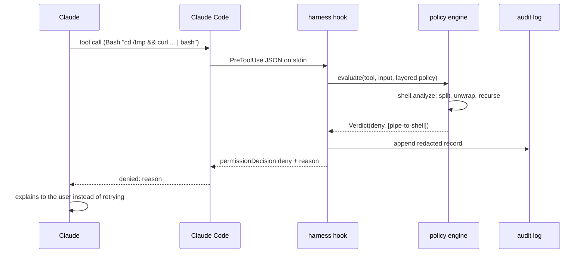

# Architecture

## What a harness is

An agent is a model running in a loop: it reads context, chooses a tool call, observes the result and repeats until it decides it is done. The **harness** is everything around the model that makes that loop safe and productive: which tools exist, what they may touch, what context the model sees, how state survives between runs, and how the result is checked.

Claude Code is itself a harness: it provides the loop, the tools, context compaction, permission prompts and extension points (hooks, subagents, skills, MCP, plugins). agent-harness uses those extension points to add four things teams usually build by hand:

1. **Governance**: a policy that understands shell commands, file paths, URLs and MCP tools, with an audit trail.
2. **Memory**: state that outlives a context window (features, progress log, checkpoints) injected at the right moments.
3. **Verification**: a gate that runs real tests before the agent may declare victory, plus an evaluator subagent that is not the author.
4. **Observability**: audit log, statistics and a status line.

## Flow of one tool call

## Modules

| Module | Responsibility |
| --- | --- |
| `shell.py` | Tokenizer and command builder: quotes, escapes, `$(...)`, backticks, `<(...)`, heredocs, redirects, pipelines, wrappers (`sudo`, `env`, `timeout`, `nice`, `xargs` ...) and nested scripts (`bash -c`, `eval`, heredoc or here-string into a shell), depth-limited |
| `policy.py` | Rules over parsed commands and tool inputs; returns a `Verdict` with every finding |
| `pathmatch.py` | Gitignore-style matcher used for every path list |
| `secrets.py` | 24 detectors, placeholder and entropy filtering, redaction, file scanning |
| `config.py` | Layer discovery, merge, schema validation |
| `hooks.py` | One handler per event, output contract, fail-open/closed |
| `store.py` | Locked JSONL audit log with rotation; per-session state |
| `progress.py` | Feature list and progress log |
| `gitinfo.py` | Branch, ahead/behind, changes, recent commits |
| `installer.py` / `settings_merge.py` | `harness init`: profiles, test-command detection, idempotent merge |
| `doctor.py` | Checks that run the configured hook for real |
| `vet.py` | Supply-chain scanner for skills, plugins and repositories |
| `skills.py` | Skill discovery, frontmatter parser and linter |
| `statusline.py` | Status line renderer |

## Why a parser and not regexes

A single Bash tool call routinely contains several commands. Regexes over the raw string either miss `cd x && rm -rf ~` and `bash -c '...'`, or flag `git commit -m "remove rm -rf from docs"`. The parser turns the string into the list of simple commands the shell would execute, each with its arguments, redirects, wrappers and pipe neighbours, so rules can reason about *which program gets which arguments*. Heredoc bodies are treated as data unless they feed a shell. When parsing fails, the command is not guessed at: the default decision is `ask`.

## Long-running agents

Following Anthropic's published harness patterns:

- **Initializer and worker roles.** The `planner` subagent turns a request into `features.json` with acceptance steps; later sessions work through it one feature at a time (`feature-loop` skill).
- **Structured handoff artifacts.** `features.json` (machine-readable, with a `passes` flag), `progress.md` (append-only narrative) and git history. `SessionStart` injects a summary; `PreCompact` writes a checkpoint so compaction does not lose track of edited files.
- **Separate evaluation.** Self-evaluation is unreliable, so the `evaluator` subagent verifies each feature by exercising it, and the `Stop` gate runs the test suite.
- **Evidence before claims.** The `Stop` claim check turns the `verification-before-completion` skill from advice into a check: a success claim after edits needs a successful test or build since the last edit.

## Workflows on top of guardrails

Hooks constrain what the agent can do; skills shape how it works. The skills are written as calm, specific procedures rather than all-caps commands: agents follow rules they understand, and forceful imperative text is also what injection scanners (including `harness vet`) look for. They are connected to the harness: `writing-plans` output imports into `features.json`, `subagent-driven-development` uses the `implementer`, `code-reviewer` and `evaluator` subagents, and progress notes record rulings so decisions survive compaction.

## Performance

Each hook is one short Python process with no third-party imports. On an Apple Silicon laptop `PreToolUse` answers in about 90 ms, most of it interpreter start-up. The PreToolUse matcher limits the hook to tools the policy understands.

## Non-goals

- Not a sandbox: it cannot stop code the agent writes from doing something harmful when executed later. Use Claude Code's sandbox or a container for untrusted work.
- Not a replacement for Claude Code permissions: `ask` decisions go through the normal prompt, and your `allow`/`deny` rules still apply.
